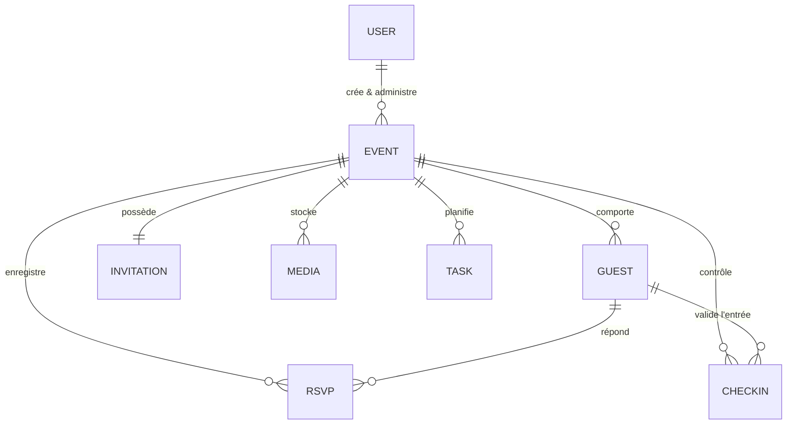

# Modèle de Données — HAPPY EVENTS

## 1. Vue d'Ensemble des Entités Relationnelles

Le schéma relationnel PostgreSQL est administré via **Prisma ORM**.

## 2. Tables Principales

### `users`
- `id` (CUID, PK)
- `name` (String, nullable)
- `email` (String, unique)
- `phone` (String, nullable)
- `avatar` (String, nullable)
- `role` (Enum: `OWNER`, `MANAGER`, `CHECKIN_AGENT`, `GUEST`, `ADMIN`, `VENDOR`)
- `createdAt`, `updatedAt`

### `events`
- `id` (CUID, PK)
- `ownerId` (FK -> users.id, cascade)
- `name` (String)
- `type` (Enum: `BIRTHDAY`, `WEDDING`, `BAPTISM`, `BABY_SHOWER`, `DOT`, `GRADUATION`, `COMMUNION`, `CORPORATE`, `OTHER`)
- `description` (Text, nullable)
- `date` (DateTime)
- `startTime`, `endTime` (String, nullable)
- `timezone` (String, default: "Africa/Abidjan")
- `venue`, `address` (String, nullable)
- `latitude`, `longitude` (Float, nullable)
- `coverImage`, `theme` (String, nullable)
- `slug` (String, unique, index)
- `status` (Enum: `DRAFT`, `PUBLISHED`, `COMPLETED`, `CANCELLED`)

### `guests`
- `id` (CUID, PK)
- `eventId` (FK -> events.id, cascade)
- `firstName`, `lastName` (String)
- `phone`, `email` (String, nullable)
- `group` (String, nullable) — e.g. "Famille", "Amis", "Table VIP"
- `isVip` (Boolean, default: false)
- `plusOneAllowed` (Boolean, default: false)
- `plusOneCount` (Int, default: 0)
- `rsvpStatus` (Enum: `PENDING`, `CONFIRMED`, `DECLINED`)
- `qrToken` (String, unique, index) — Token sécurisé pour le scan à l'entrée
- `checkedIn` (Boolean, default: false)

### `rsvps`
- `id` (CUID, PK)
- `eventId` (FK -> events.id, cascade)
- `guestId` (FK -> guests.id, cascade)
- `status` (Enum: `PENDING`, `CONFIRMED`, `DECLINED`)
- `attendeeCount` (Int, default: 1)
- `dietaryPreference` (String, nullable)
- `message` (Text, nullable)
- `respondedAt` (DateTime, default: now())

### `invitations`
- `id` (CUID, PK)
- `eventId` (FK -> events.id, unique, cascade)
- `templateId` (String, default: "classic-gold")
- `title` (String)
- `content` (Text)
- `themeConfig` (Json, nullable)
- `published` (Boolean, default: false)
- `publishedAt` (DateTime, nullable)

### `checkins`
- `id` (CUID, PK)
- `eventId` (FK -> events.id, cascade)
- `guestId` (FK -> guests.id, cascade)
- `checkedInAt` (DateTime, default: now())
- `checkedInBy` (String) — Identifiant de l'agent ayant validé l'entrée

### `medias` & `tasks`
- `medias` : Médias partagés (photos/vidéos) pour la galerie et Happy Memories.
- `tasks` : Liste de tâches et rétroplanning de l'organisateur.
